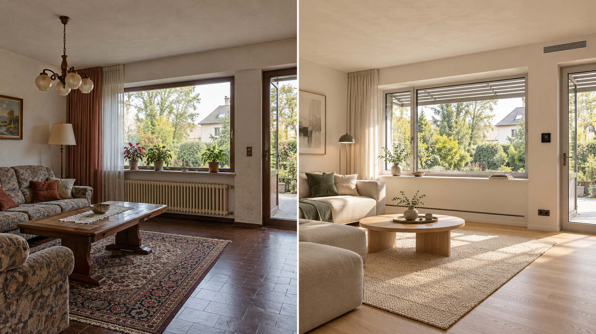
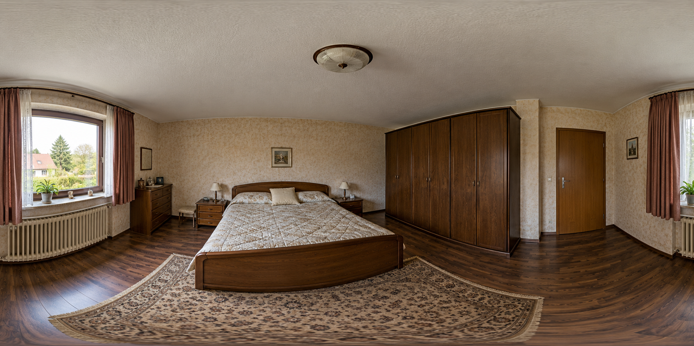
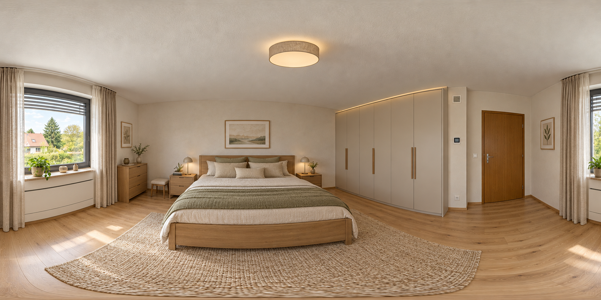

  

<h1 align="center">PLANORA</h1>

  From an existing floor plan to a sustainable vision for the home.

  
  
  

## The idea behind PLANORA

PLANORA began as an idea during a Makerthon hosted by the **Makerspace at Ruhr University Bochum (RUB)**: turn structured building data into an accessible renovation experience that helps people understand what an existing property could become.

At the event, the **A-Team worked as the blixdata team** and collaboratively created the dashboard needed to present and explore building data supplied through blixdata.

After the Makerthon, **Sara Saido** discussed the concept with members of the jury, who encouraged its potential. Building on the experience and ideas developed during the event, she created this expanded portfolio version independently over the following weekend.

The project reflects a simple principle: promising ideas should not remain unfinished.

## Makerthon, A-Team and blixdata

The Makerthon dashboard was a shared achievement of the **A-Team**, working together as the **blixdata team** at the Makerthon hosted by the **Makerspace at RUB**. blixdata provided the structured building-data context that made the dashboard concept possible.

This public showcase respectfully acknowledges that collaborative foundation while presenting Sara's independently expanded post-Makerthon concept. It is not the original A-Team submission.

## Product vision

PLANORA explores how structured building information can support an understandable renovation journey. The prototype brings together:

- interpretation of rooms, doors and windows from structured plan data;
- comparison of renovation scenarios;
- accessible explanations of indicative costs and time ranges;
- technical modernization topics and missing evidence;
- interactive room concepts and AI-assisted visual inspiration;
- bilingual presentation in German and English.

## Visual concept

  
  

The visuals demonstrate a possible transformation of an existing interior. They are conceptual and do not represent an execution-ready design.

## Source-code access

The implementation and project data are maintained in a **private repository** to protect the original concept and technical work. Selected access may be granted upon request.

## Responsible use

PLANORA is a portfolio prototype and decision-support concept. It is not a verified digital twin, engineering design, binding quotation or construction schedule. Dimensions, structure, building services, permissions, local requirements and contractor quotations must be professionally verified before real-world decisions are made.

## Author

**Sara Saido**  
Civil Engineering · BIM · Python · Java · Applied AI

© 2026 Sara Saido. Portfolio materials; all rights reserved.
